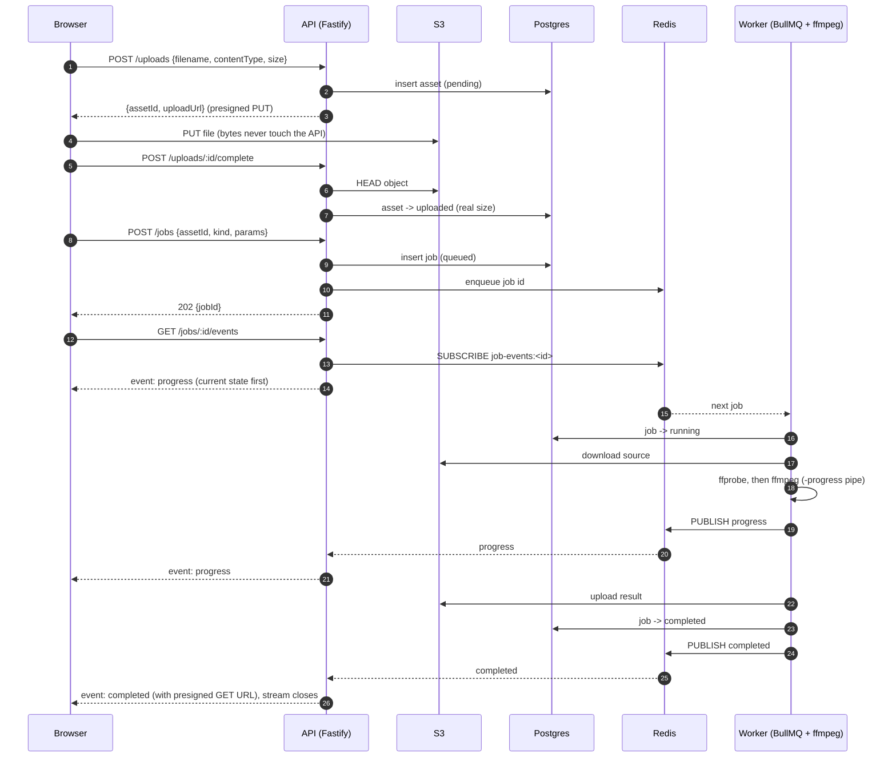
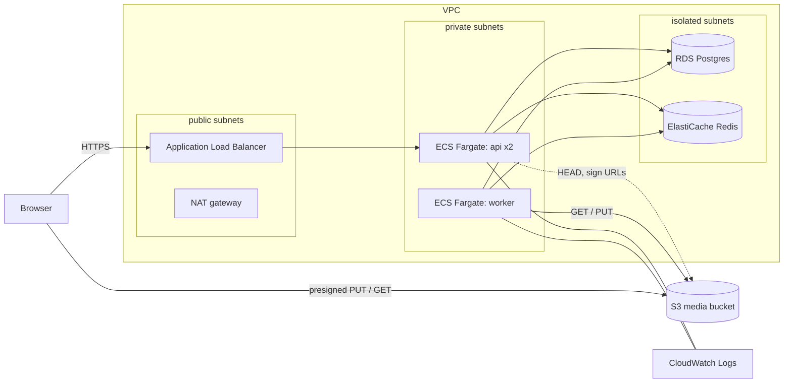

# render-queue

An API for media uploads and render jobs: browsers upload straight to S3 with presigned URLs, a BullMQ worker runs
ffmpeg, and progress streams back over server-sent events. It ships as containers for AWS ECS Fargate, with a CDK app
that synthesises the whole stack and a docker-compose file that runs the same thing on a laptop.

Node 22, TypeScript (strict), Fastify 5, Zod, BullMQ, Drizzle on Postgres, `@aws-sdk/client-s3`, ffmpeg, Vitest, AWS CDK.

## How a render flows



## Endpoints

All endpoints except `/health`, `/ready` and `/docs` need an `x-api-key` header. Errors are `application/problem+json`
([RFC 9457](https://www.rfc-editor.org/rfc/rfc9457)). The OpenAPI document is generated from the Zod schemas and
served at `/docs` (UI) and `/docs/json`.

| Method | Path | Purpose | Success |
| --- | --- | --- | --- |
| `POST` | `/uploads` | `{ filename, contentType, size }` returns `{ assetId, uploadUrl, expiresAt, headers }`, a presigned S3 PUT. Only `video/*` and sizes up to the limit are accepted. | `201` |
| `POST` | `/uploads/:assetId/complete` | HEADs the object, reads its real size, marks the asset `uploaded`. Idempotent. | `200` |
| `POST` | `/jobs` | `{ assetId, kind, params }` where `kind` is `thumbnail` `{ time }`, `transcode` `{ preset: "h264-720p" \| "h264-480p" }` or `trim` `{ start, end }`. Enqueues the job. | `202` `{ jobId }` |
| `GET` | `/jobs/:id` | Status, progress (0-100), and the result (with a presigned GET URL) or the error. | `200` |
| `GET` | `/jobs/:id/events` | Server-sent events: `progress`, `completed`, `failed`. Starts from the current state, sends a heartbeat, closes when the job ends. | `200` stream |
| `GET` | `/health` | Liveness. | `200` |
| `GET` | `/ready` | Readiness: Postgres, Redis and S3 are reachable. | `200` / `503` |

Status codes for errors: `400` malformed request, `401` bad key, `404` unknown asset or job, `409` state conflict (upload
not finished, asset not uploaded), `422` a rule rejected the input (not a video, too big, `end <= start`), `429` rate
limit, `503` a dependency is down.

## Run it locally

You need Docker, `curl` and `jq`. The stack is Postgres, Redis, an S3-compatible store
([RustFS](https://github.com/rustfs/rustfs)), the migrations, the API and the worker.

```bash
docker compose up --build
```

When `api` reports it is listening, the API is on `http://localhost:3000` (docs at `/docs`) and the RustFS console on
`http://localhost:9001` (`rustfsadmin` / `rustfsadmin`). Host ports can be moved with `POSTGRES_PORT`, `REDIS_PORT`,
`S3_PORT`, `S3_CONSOLE_PORT` and `API_PORT` if something else is using them; presigned URLs follow `S3_PORT`.

### A full render with curl

```bash
export API=http://localhost:3000
export KEY=dev-api-key-change-me-0123456789      # API_KEY in docker-compose.yml

# any video will do; this makes a 6-second test clip
ffmpeg -f lavfi -i testsrc=duration=6:size=640x360:rate=24 -f lavfi -i sine=duration=6 \
  -c:v libx264 -pix_fmt yuv420p -c:a aac -shortest sample.mp4

# 1. ask for an upload URL
UPLOAD=$(curl -s $API/uploads -H "x-api-key: $KEY" -H 'content-type: application/json' \
  -d "{\"filename\":\"sample.mp4\",\"contentType\":\"video/mp4\",\"size\":$(wc -c < sample.mp4 | tr -d ' ')}")
ASSET=$(echo "$UPLOAD" | jq -r .assetId)

# 2. send the bytes straight to S3 (the Content-Type must match what was signed)
curl -s -X PUT "$(echo "$UPLOAD" | jq -r .uploadUrl)" -H 'content-type: video/mp4' --data-binary @sample.mp4

# 3. tell the API it is there
curl -s -X POST $API/uploads/$ASSET/complete -H "x-api-key: $KEY" | jq

# 4. start a job
JOB=$(curl -s $API/jobs -H "x-api-key: $KEY" -H 'content-type: application/json' \
  -d "{\"assetId\":\"$ASSET\",\"kind\":\"transcode\",\"params\":{\"preset\":\"h264-480p\"}}" | jq -r .jobId)

# 5. watch it (ends by itself)
curl -N $API/jobs/$JOB/events -H "x-api-key: $KEY"

# 6. fetch the result
curl -s $API/jobs/$JOB -H "x-api-key: $KEY" | jq
curl -s -o out.mp4 "$(curl -s $API/jobs/$JOB -H "x-api-key: $KEY" | jq -r .result.downloadUrl)"
```

Other job bodies: `{"kind":"thumbnail","params":{"time":2.5}}`, `{"kind":"trim","params":{"start":1,"end":4}}`.

### Develop against the stack

```bash
cp .env.example .env
docker compose up -d postgres redis s3 s3-init
pnpm install
pnpm dev            # applies migrations, then runs the API and the worker with reload
```

`pnpm dev` expects `ffmpeg` and `ffprobe` on your `PATH`.

## Scripts and tests

| Command | What it does |
| --- | --- |
| `pnpm gate` | typecheck + lint + unit tests + build; CI runs this |
| `pnpm test` | unit tests only (no network, no Docker) |
| `pnpm test:integration` | integration tests; needs Postgres, Redis, an S3-compatible store and ffmpeg (see `.env.example` for the variables) |
| `pnpm db:generate` | generate a migration from `src/adapters/drizzle/schema.ts` |
| `pnpm db:migrate` | apply the committed migrations |

Unit tests cover the domain (value objects, job status transitions, job specs), every use case against in-memory fakes
of the ports, the ffmpeg progress parser and argument builder, the HTTP layer (auth, problem+json, validation, rate
limiting, OpenAPI, the SSE stream over a real socket), and configuration. Integration tests are tagged and skipped unless
`INTEGRATION=1`: they exercise the Drizzle repositories on Postgres, the Redis pub/sub bus, BullMQ retry semantics, and
the whole upload, job, worker and SSE pipeline against RustFS with real ffmpeg output checked through ffprobe. RustFS
enforces signatures like S3, so a PUT whose content type differs from the signed one is refused with 403.

CI (`.github/workflows/ci.yml`) has three jobs: `gate`, `infra` (typecheck and `cdk synth`) and `integration` (Postgres,
Redis and RustFS service containers, ffmpeg from apt).

## Architecture

Hexagonal and small. Dependencies point inwards; each process has one composition root that is the only place that
picks concrete classes.

```
src/
  domain/      Asset, Job, status rules, JobSpec (a discriminated union), value objects. Pure.
  app/         use cases: CreateUpload, CompleteUpload, CreateJob, GetJob, WatchJob, RunJob
  ports/       ObjectStore, JobQueue, JobRepository, AssetRepository, MediaTool, ProgressBus (+ Clock, Logger, ...)
  adapters/    s3/ bullmq/ drizzle/ ffmpeg/ redis/ system/
  http/        Fastify app: routes, Zod schemas, problem+json, API key, SSE session
  composition/ api-composition.ts, worker-composition.ts   (the two composition roots)
  main-api.ts, main-worker.ts, migrate.ts                  (process entry points)
```

- **Job kinds are a discriminated union** (`thumbnail | transcode | trim`), and every `switch` over it ends in
  `assertNever`, so adding a kind is a compile error everywhere it matters.
- **Value objects only where they carry a rule:** `ContentType.video()` accepts `video/*`, `ByteSize` enforces a positive
  integer and a limit, `Filename` rejects path separators.
- **One place guards status changes.** `domain/job-status.ts` holds the transition table:
  `queued -> running -> completed | failed`. `running -> running` is a new attempt (a retry, or a job found
  still running after a worker crashed); everything else throws a `ConflictError`.
- **Errors:** domain errors carry a kind (`validation`, `not_found`, `conflict`, `unavailable`); the HTTP layer maps
  kinds to statuses in one table and renders RFC 9457 problem details with a stable `code`. Unknown errors become an
  opaque 500.

## AWS (documented, not deployed)



`infra/` is a self-contained CDK app (TypeScript, aws-cdk-lib v2): a VPC across two AZs with public, private and isolated
tiers and an S3 gateway endpoint; a Fargate service for the API behind an ALB (health check on `/health`, a 120 s idle
timeout for SSE, CPU-based autoscaling); a Fargate service for the worker (`stopTimeout` of 120 s, 50 GiB ephemeral
storage, init process); RDS Postgres 17; ElastiCache Redis 7 with `maxmemory-policy noeviction`, in-transit and
at-rest encryption; an encrypted private S3 bucket with CORS for the browser and lifecycle rules; Secrets Manager for the
database password and the API key; one task role per service limited to `s3:GetObject`, `s3:PutObject` on the bucket
objects and `s3:ListBucket` on the bucket; and a CloudWatch log group per container.

```bash
cd infra
pnpm install
pnpm synth                                  # works offline, no AWS credentials needed
npx cdk deploy -c corsOrigins='["https://app.example.com"]' -c certificateArn=arn:aws:acm:...   # not done for this repo
```

- Deploying builds both Dockerfiles as CDK image assets, so it needs Docker and a bootstrapped account.
- **Migrations** are a task definition, not part of service start-up, so replicas never race. After each deploy, run the
  `MigrateCommand` stack output once (an `aws ecs run-task`) before shifting traffic.
- Without `certificateArn` the load balancer serves plain HTTP. Set it to terminate TLS and redirect port 80.
- Left out on purpose: queue-depth autoscaling for the worker (needs a custom CloudWatch metric), WAF, a custom domain, a
  multi-AZ database. The defaults favour a small bill over resilience.

## Design choices

**Presigned uploads.** Video files are large. Proxying them through the API would tie up Fastify connections and memory,
double the bandwidth bill, and make the API the bottleneck. The API instead signs a PUT URL and steps aside. The
signature binds the `Content-Type` and `Content-Length` the client declared, so S3 rejects an upload that does not match
what passed validation. `complete` then HEADs the object and records the real size, which is the point where "the client
says it uploaded" becomes "the object exists". The upload size limit is enforced at signing time and checked again at
completion.

**SSE over WebSockets.** Progress is one-way, server to client, over ordinary HTTP. SSE is enough, works through ALBs and
proxies without upgrade handling, needs no sticky sessions, and reconnects by itself. The stream always starts with the
job's current state, so a reconnect or a late subscriber never misses the outcome, and `WatchJob` subscribes to Redis
before it reads the stored state so nothing published in between is lost. Heartbeats keep idle proxies from closing the
connection. `EventSource` cannot set headers, so a browser client reads the stream with `fetch` and the `x-api-key`
header; the endpoint documents this.

**Idempotency and retries.**
- The BullMQ job id is the job's id, so enqueuing twice is a no-op.
- The queue carries only the id. The row in Postgres is the source of truth, and `RunJob` skips a job that is already
  `completed` or `failed`, so a duplicate delivery does nothing.
- Output keys are deterministic (`renders/<jobId>/output.<ext>`) and the result asset reuses the job id, so re-running an
  attempt overwrites rather than duplicates.
- Jobs get 3 attempts with exponential backoff. Bad input (unreadable media, a trim that starts after the video ends, a
  missing source) is a `PermanentJobError`: it is recorded, announced and mapped to BullMQ's `UnrecoverableError`, so it is
  not retried. Anything else is transient and retried; on the last attempt the failure is recorded and announced.
- `CreateJob` writes the row before the queue entry and deletes the row if the enqueue fails, so a 503 leaves nothing
  behind.
- On SIGTERM (how ECS stops a task) the worker stops taking jobs and waits for running ones. If they outlast the grace
  period, they are aborted, ffmpeg is killed, and each job is handed back to the queue without spending an attempt.
  If the process is killed outright instead, BullMQ's stalled-job check returns the job to the queue and the next
  attempt picks up the `running` row.

**API key and rate limit.** A single key from the environment, compared in constant time (both sides are hashed first, so
length does not leak). Requests are rate limited per client address, with counters in Redis so the limit holds across API
tasks; `/health` and `/ready` are exempt.

**Known limits.**
- A job BullMQ marks failed because it stalled more than once never reaches the use case, so its Postgres row would stay
  `running`. A reconciliation sweep would close that gap.
- `DATABASE_SSL=require` encrypts the connection but does not verify the server certificate; pin the RDS CA bundle for a
  stricter setup.
- The worker uploads results through `@aws-sdk/lib-storage` (multipart for large files), so a result can be as large as S3
  allows, but a 5 GiB-plus source still needs the browser to upload in parts; the presigned flow signs a single PUT.

## Configuration

| Variable | Used by | Default |
| --- | --- | --- |
| `DATABASE_URL` or `DB_HOST`, `DB_PORT`, `DB_NAME`, `DB_USER`, `DB_PASSWORD` | all | none (required) |
| `DATABASE_SSL` (`disable` or `require`) | all | `disable` |
| `REDIS_URL` | api, worker | none (required) |
| `S3_BUCKET`, `S3_REGION` | api, worker | none, `us-east-1` |
| `S3_ENDPOINT`, `S3_PUBLIC_ENDPOINT`, `S3_FORCE_PATH_STYLE` | api, worker | unset (real AWS), unset, `false` |
| `API_KEY` | api | none (required, 16+ characters) |
| `PORT`, `HOST`, `CORS_ORIGINS` (comma separated) | api | `3000`, `0.0.0.0`, none |
| `MAX_UPLOAD_BYTES`, `UPLOAD_URL_TTL_SECONDS`, `DOWNLOAD_URL_TTL_SECONDS` | api | 2 GiB, 900, 3600 |
| `RATE_LIMIT_MAX`, `RATE_LIMIT_WINDOW_SECONDS` | api | 120, 60 |
| `SSE_HEARTBEAT_MS` | api | 15000 |
| `JOB_ATTEMPTS`, `JOB_BACKOFF_MS` | api (producer) | 3, 5000 |
| `WORKER_CONCURRENCY`, `WORK_DIR`, `SHUTDOWN_GRACE_MS`, `FFMPEG_PATH`, `FFPROBE_PATH` | worker | 2, `/tmp`, 100000, `ffmpeg`, `ffprobe` |

AWS credentials come from the SDK's default chain: the task role on ECS, `AWS_ACCESS_KEY_ID` and
`AWS_SECRET_ACCESS_KEY` locally. `S3_PUBLIC_ENDPOINT` exists because inside Docker the API reaches the store as
`http://s3:9000` while the browser needs the URL in the presigned link to be `http://localhost:9000`.

## Licence

MIT, see [LICENSE](LICENSE).
